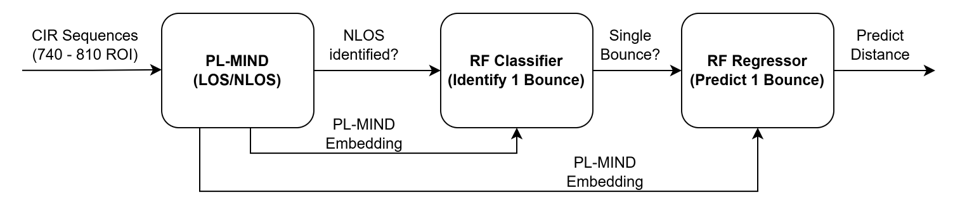
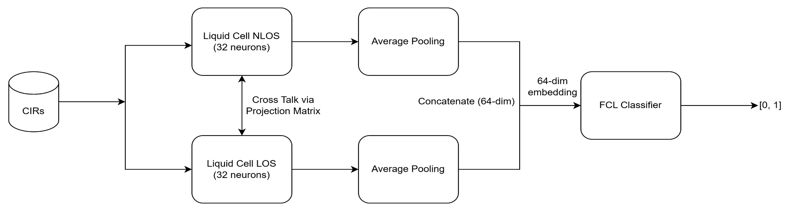

# PL-MIND: Physics-Informed Liquid Neural Networks for UWB NLOS Identification

UWB ranging becomes inaccurate when the direct path between two devices is blocked (non-line-of-sight, NLOS), because the receiver measures a longer, reflected path. This project identifies NLOS conditions from the UWB channel impulse response (CIR), picks out clean single-bounce reflections and estimates the length of the reflected path. At its core is the PL-MIND encoder, a dual-circuit liquid neural network whose time constant adapts to the incoming signal.

The repository contains the code, dataset and trained models of a final-year capstone project and of the paper based on it, published at IEEE PIMRC 2026.

## Project Information

| Item | Details |
|---|---|
| Module | CSC3101 Capstone Project |
| Programme | BSc (Hons) Computing Science, University of Glasgow and Singapore Institute of Technology |
| Student | Lim Jing Chuan Jonathan |
| Supervisors | Assoc. Prof. Chee Kiat Seow (University of Glasgow), Asst. Prof. Nalam Venkata Abhishek (Singapore Institute of Technology) |
| Paper | *PL-MIND: Physics-Informed Liquid Neural Networks for Multichannel Identification of NLOS Dynamics in Indoor Positioning*, IEEE PIMRC 2026 |

## Overview



Stage 1 classifies each CIR as LOS or NLOS. For NLOS signals, a random forest in Stage 2 checks whether the CIR holds a clean single bounce, and a random forest regressor in Stage 3 predicts where that bounce arrives, which gives the corrected path length. Stages 2 and 3 reuse the frozen 64-dimensional PL-MIND embedding.



The encoder has two liquid circuits of 32 neurons that read the same 60-sample CIR window and exchange information through gated projections. A separation loss on their time constants pushes one circuit towards LOS and the other towards NLOS behaviour. Every scenario is recorded on six UWB channels, and LSTM, 1D-CNN and BERT-style Transformer encoders trained the same way serve as baselines.

## Results

| Encoder | Parameters | Stage 1 ID acc. | Stage 1 OOD acc. | Stage 2 OOD acc. |
|---|---|---|---|---|
| PL-MIND | 16,897 | 0.98 | 0.97 | 0.82 |
| LSTM | 19,265 | 1.00 | 0.81 | 0.76 |
| CNN | 19,617 | 1.00 | 0.93 | 0.76 |
| BERT | 73,153 | 1.00 | 0.94 | 0.71 |

ID is the test split of the training environments and OOD are environments never seen in training. Stage 3 reaches MAE 0.2458 m, RMSE 0.6369 m and R² 0.8937 on 152 held-out single-bounce samples. Tables I and II of the paper also give the AUC values.

## Getting Started

Python 3.10 to 3.13 is required (the notebooks were run with Python 3.13). A GPU is optional.

```bash
git clone https://github.com/jonathanljc/csc3101-capstone-pl-mind.git
cd csc3101-capstone-pl-mind
python -m venv .venv
.venv\Scripts\activate           # Windows (macOS / Linux: source .venv/bin/activate)
pip install -r requirements.txt
jupyter lab
```

On Windows, `pip` installs the CPU-only build of PyTorch. To use an NVIDIA GPU, install the CUDA build from [pytorch.org](https://pytorch.org/get-started/locally/) first, for example `pip install torch==2.7.1 --index-url https://download.pytorch.org/whl/cu118`.

The notebooks load files relative to their own folder, so keep the folder layout as it is. They are saved with their outputs and can also be read on GitHub without running them.

## Repository Structure

```
csc3101-capstone-pl-mind/
├── dataset/                CIR captures, combined datasets and calibration captures
├── setup/                  scripts that turn the DWM1001 serial log into CSV files
├── lnn/                    PL-MIND encoder, Stage 2, Stage 3 and the full pipeline
├── lstm/, cnn/, bert/      baselines
├── novelty1_multichannel/  single-channel vs multi-channel analysis
├── docs/                   figures used in this README
├── eda.ipynb               calibration, multi-channel analysis and ground-truth labels
├── stage1_metrics_reference.ipynb     Stage 1 results of all encoders (Table I)
├── stage2_rf_metrics_reference.ipynb  Stage 2 results of all encoders (Table II)
└── requirements.txt
```

The READMEs in `lnn/`, `lstm/`, `cnn/` and `bert/` list their notebooks in the order to run them, and [lnn/README.md](lnn/README.md#model) also shows how the code implements the equations of the paper.

## Dataset

The data was collected with two Decawave DWM1001 modules using single-sided two-way ranging. Each scenario was recorded on channels 1, 2, 3, 4, 5 and 7 with 100 captures per channel, and each channel was calibrated against a laser distance meter.

| Set | File | Scenarios | Samples |
|---|---|---|---|
| In-distribution (train, validation, test) | `dataset/channels/combined_uwb_dataset.csv` | 8.41 m, 9.29 m, 9.76 m LOS; 9.54 m, 16.09 m, 16.80 m NLOS | 3600 |
| Out-of-distribution (test only) | `dataset/channels/unseen_dataset.csv` | 4.55 m, 10.19 m LOS; 8.91 m, 12.79 m NLOS | 2400 |

See [dataset/README.md](dataset/README.md) for the locations and columns and [setup/README.md](setup/README.md) for the capture scripts.
